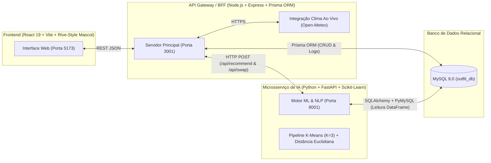
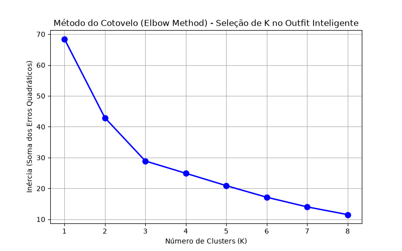

# 🤖 Outfit Inteligente — Personal Stylist & Provador Virtual com IA

> **Projeto Acadêmico Fullstack & Machine Learning**  
> Sistema inteligente de gestão de guarda-roupa pessoal e recomendação de vestuário baseada em **Clima em Tempo Real (Geolocalização)**, **Processamento de Linguagem Natural (NLP)** e **Agrupamento Não Supervisionado K-Means (`Scikit-Learn`)**.

---

## 🎯 Visão Geral do Produto

O **Outfit Inteligente** resolve a fadiga de decisão diária (*"O que eu visto hoje?"*) cruzando automaticamente três fontes de informação:
1. **Clima Ao Vivo por Geolocalização (Open-Meteo API):** Detecta automaticamente a cidade do usuário, temperatura atual, sensação térmica, nebulosidade e condição/risco de chuva.
2. **Intenção em Linguagem Natural:** O usuário apenas escreve em português para onde vai e como quer se vestir (ex.: *"Vou levar minha namorada pra jantar, queria ir com uma roupa neutra, verifique o tempo e se estiver com condições de chuva quero um moletom para levar"*).
3. **Acervo Real do Usuário + Provador Virtual:** Todas as recomendações utilizam as roupas reais cadastradas no banco de dados MySQL do usuário (com suporte a upload de foto pelo computador/celular), exibidas em um **Provador Virtual** acompanhado de um **Mascote 3D Interativo** (com *Eye Tracking* que acompanha o mouse e estados de animação).

---

## 🏗️ Arquitetura do Sistema (Microsserviços & Dual-ORM)

O projeto adota uma arquitetura desacoplada onde cada tecnologia atua em sua especialidade:



### Divisão de Responsabilidades no Banco de Dados (`outfit_db`)
* **Escrita e Operações Transacionais (`Node.js` + `Prisma ORM`):** Cadastro e exclusão de peças (`wardrobe_items`, com fotos em `LONGTEXT`), listagem do catálogo e persistência de looks favoritos (`outfit_logs`).
* **Leitura Analítica e Vetorização (`Python` + `SQLAlchemy` + `Pandas`):** Carregamento do acervo diretamente em *DataFrames* para pré-processamento matricial e inferência em tempo real com `Scikit-Learn`.

---

## 🧠 Ciência de Dados & Machine Learning (`ml-service-python/`)

### 1. Pré-Processamento de Dados (`StandardScaler` + `OneHotEncoder`)
O algoritmo **K-Means** baseia-se em distâncias geométricas (Distância Euclidiana). Como o banco de dados possui variáveis em escalas numéricas distintas e variáveis categóricas em texto, implementamos um pipeline completo:
* **Variáveis Numéricas (`ideal_temp` de `5°C` a `35°C`, `formality_level` de `1` a `5`):** Padronizadas via `StandardScaler` ($\mu = 0, \sigma = 1$) para evitar que a grandeza numérica da temperatura domine o peso da formalidade.
* **Variável Categórica (`color`):** Convertida em vetores binários ortogonais via `OneHotEncoder(sparse_output=False)` sem criar ordenação artificial entre cores.
* **Variável Binária (`rain_resistant`):** Mantida em escala `[0, 1]`.

### 2. Determinação Matemática de $K = 3$ pelo Método do Cotovelo (*Elbow Method*)
Para definir cientificamente o número ideal de agrupamentos ($K$) sem chutar valores arbitrários, executamos o script [`ml-service-python/elbow_analysis.py`](./ml-service-python/elbow_analysis.py) testando $K \in [1, 8]$ e medindo a **Inércia (WCSS — *Within-Cluster Sum of Squares*)**:



O ponto de inflexão ("cotovelo") ocorre em **$K = 3$**, dividindo o guarda-roupa em três perfis climáticos e sociais naturais:
1. **Frio, Chuva & Formal / Urbano** (Casacos, sobretudos, jaquetas, calças estruturadas e calçados resistentes à água);
2. **Clima Ameno & Social / Trabalho** (Camisas sociais, polos, calças chino/jeans e sapatos/sapatênis);
3. **Calor & Casual / Esporte** (Camisetas leves, bermudas, tênis esportivos e sandálias).

> **Rotulagem Dinâmica de Centróides:** Como o K-Means pode permutar os índices numéricos (`0, 1, 2`) quando novas roupas são cadastradas pelo usuário, o motor em [`recommender.py`](./ml-service-python/recommender.py) inspeciona dinamicamente a média real de temperatura e formalidade de cada centróide após o `.fit()` para nomear o cluster com 100% de precisão.

### 3. Recomendação Completa (`/api/recommend`) e Troca Inteligente de Peça (`/api/swap`)
* **Interpretador NLP em Português:** Extrai do texto livre do usuário a **ocasião** (`trabalho`, `date`/jantar, `esporte`, `festa`, `casual`), **cores e paletas** (`neutro`, `escuro`, `claro`), **peças específicas pedidas pelo nome** (ex.: `"moletom"`, `"jaqueta"`, `"camisa"`) e **condicionais climáticas** (*"se estiver com condições de chuva quero um moletom"*).
* **Troca Individual (`/api/swap`):** Quando o usuário clica em **"↻ Outra opção"** em apenas uma peça no Provador (ex.: apenas o calçado), o sistema filtra a mesma categoria e retorna o **próximo vizinho mais próximo** por Distância Euclidiana Ponderada que ainda não foi exibido naquela sessão (`ids_vistos`), mantendo o restante do look intacto.

---

## 📂 Estrutura de Pastas do Repositório

```text
outfit_inteligente/
├── database/
│   ├── schema.sql               # DDL das tabelas users, wardrobe_items e outfit_logs
│   └── seed.sql                 # Carga inicial com 15 peças variadas nos 3 clusters
├── ml-service-python/
│   ├── elbow_analysis.py        # Script que calcula a Inércia (WCSS) e gera o gráfico
│   ├── explore_clusters.py      # Script de inspeção dos centróides do K-Means
│   ├── grafico_cotovelo.png     # Evidência visual do Método do Cotovelo (K=3)
│   ├── recommender.py           # Pipeline Scikit-Learn + NLP + Recomendação e Troca
│   ├── main.py                  # Servidor FastAPI (Porta 8001)
│   └── requirements.txt         # Dependências Python
├── backend-node/
│   ├── prisma/
│   │   └── schema.prisma        # Schema introspectado do MySQL para o Prisma Client
│   ├── server.js                # API Gateway Express + Prisma + Open-Meteo (Porta 3001)
│   ├── .env.example             # Modelo de variáveis de ambiente
│   └── package.json             # Dependências Node.js
├── frontend/
│   ├── public/                  # Ativos estáticos e camadas transparentes do Mascote 3D
│   ├── src/
│   │   ├── components/
│   │   │   ├── MannequinPreview.jsx # Provador Virtual + Balão de Fala + Modo Banca
│   │   │   └── RobotMascotRive.jsx  # Mascote Interativo com Eye Tracking e Estados
│   │   ├── api.js               # Cliente HTTP centralizado
│   │   ├── App.jsx              # Aplicação Principal
│   │   └── index.css            # Design System & Animações
│   └── package.json             # Dependências React + Vite
├── DECISOES.md                  # Registro de Decisões de Arquitetura (ADR-001 a ADR-016)
└── README.md                    # Documentação Principal
```

---

## 🚀 Como Executar o Projeto Localmente (Guia Rápido dos 3 Terminais)

### Pré-requisitos
* **MySQL Server 8.0+** rodando na porta `3306` (com os scripts `database/schema.sql` e `database/seed.sql` executados no banco `outfit_db`).
* **Node.js 20+** e **Python 3.10+**.

### 1️⃣ Terminal 1 — Microsserviço de IA Python (Porta `8001`)
```powershell
cd ml-service-python
.\venv\Scripts\Activate
uvicorn main:app --reload --port 8001
```

### 2️⃣ Terminal 2 — Backend Principal Node.js + Prisma (Porta `3001`)
```powershell
cd backend-node
npm run dev
```

### 3️⃣ Terminal 3 — Frontend React + Vite (Porta `5173`)
```powershell
cd frontend
npm run dev
```
Acesse no navegador: **`http://localhost:5173`**

---

## 🎓 Dica para a Apresentação à Banca (`Modo Banca`)
No canto superior direito da interface, clique no botão **`🎓 Modo Banca`**. Ele revela instantaneamente na tela do Provador as métricas internas do modelo **Scikit-Learn K-Means** (Cluster selecionado, Ocasião inferida, Nível de Formalidade e Temperatura Ideal de cada peça) para demonstração técnica ao professor!
